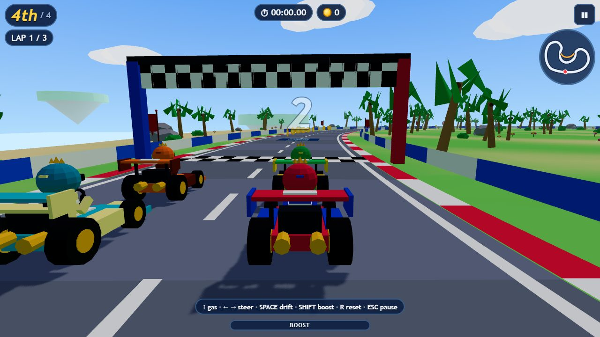

# 1. The game at a glance

**Sky Kart 3D: Island Grand Prix** is a 3D kart racing game that runs in a web browser, on a PC or on a phone. You race three computer drivers around 12 tracks built on floating islands in the sky. You collect coins, drift for boosts, jump off ramps, find a shortcut on every track, finish missions, and spend your coins in a garage on new karts, upgrades and paint.

This guide explains **how the game is built**: every folder and every file, what each one does, how they work together, the order to build them in, how to run and host the game, and how it was tested.

## The game in one table

| What | Value |
|---|---|
| Name | Sky Kart 3D: Island Grand Prix |
| Kind of game | Arcade kart racer, single player against 3 computer drivers |
| Where it runs | Any modern browser with WebGL: PC (keyboard or gamepad) and phone or tablet (touch) |
| Built with | Vite 5, React 18, JavaScript, React Three Fiber 8, Three.js 0.169, Zustand 4, Howler 2 |
| Tracks | 12, each with its own shape, theme, weather, scenery, surfaces, obstacles and a shortcut |
| Race | 4 karts, 3 laps, countdown, ordered checkpoints, live positions |
| Garage | 5 karts, 4 upgrades with 5 levels each, 8 paints, 5 drivers, 4 wings |
| Progress | Stars (1 to 3 per track), 3 tasks per track, 20 missions, coins, best times |
| Art and sound | All made in code. No downloaded images, models, fonts, sounds or music |
| Size of the finished game | 1.6 MB in `dist/` (about 330 KB of zipped JavaScript and CSS) |
| Saving | In the browser (`localStorage`), nothing is sent anywhere |
| Project folder | `your Sky Kart 3D checkout` |

## What was built, step by step

1. **The rules first, without graphics.** Track data, the track builder and the race simulation were written as plain JavaScript that also runs in Node.js. This way every track could be checked by a program before anything was drawn.
2. **Twelve tracks as data.** Each track is a list of points of a smooth closed curve plus a theme. A placement module finds good spots for boost pads, ramps, sand, ice, swinging boulders, coins and the shortcut.
3. **The 3D world.** Road, walls, floating island, scenery and karts are built from simple shapes with colours painted on the corners (no pictures), so the game stays small and fast.
4. **The screens.** Main menu, world map, garage, missions, settings, pause and results, in React.
5. **Saving and rewards.** One save object, checked and repaired when it is loaded, written to the browser after every reward or purchase.
6. **Touch controls, sound and music**, all made in code.
7. **Tests.** Programs check the tracks, the rules, the save, full AI races, the gameplay and a real browser.

## What is finished, and what is not tested yet

Everything listed in the table above works and is checked by the test programs (see chapter 7).

> **Honest status:** The game has **not** been tried on a real phone yet. Touch was tested only by a phone emulator inside Chrome. The frame rate on real devices has not been measured, the sound has not been listened to by a person, and only Google Chrome was used. Chapter 8 lists all known limits.

## How to read this guide

| If you want to... | Read |
|---|---|
| See every folder and file and what it does | Chapter 2 |
| Understand how the files talk to each other | Chapter 3 |
| Build the same game yourself, in order | Chapter 4 |
| Know everything the game can do | Chapter 5 |
| Play it, build it or put it online | Chapter 6 |
| See how it was tested | Chapter 7 |
| Change it or add a track, kart or mission | Chapter 8 |
| Look up a word | Chapter 9 |
