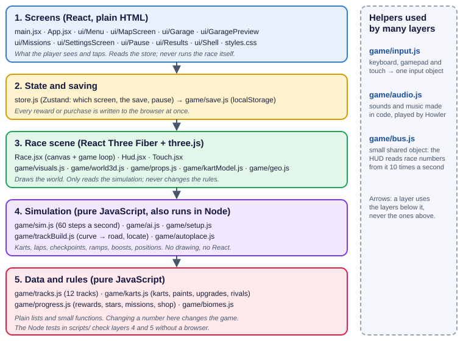
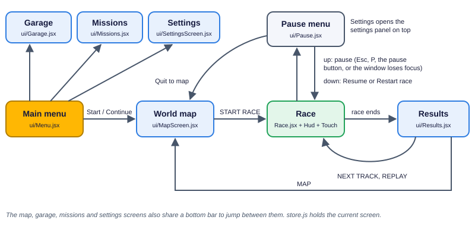
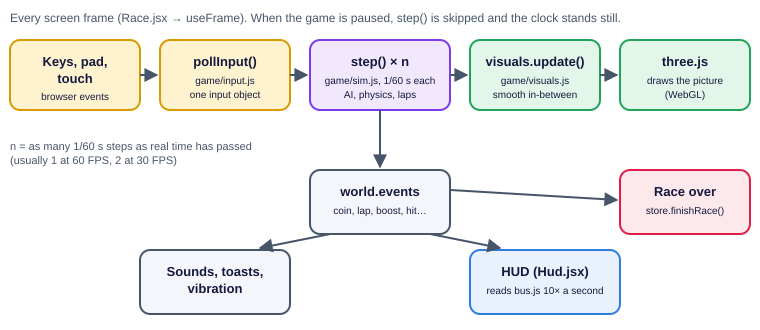

# 3. How the files work together

Chapter 2 listed the files one by one. This chapter shows how they connect: the layers, the screens, what happens in one frame, how a track goes from data to a 3D road, and how the save works.

## The five layers

The code is stacked in five layers. A layer may use the layers **below** it, never the ones above. This is the most important rule of the project: it is why the rules and the simulation can be tested in Node.js without a browser, and why the 3D picture can never change the result of a race.

| Layer | Folder | Knows about React? | Knows about three.js? | Runs in Node tests? |
|---|---|---|---|---|
| 1. Screens | `src/ui/`, `App.jsx` | yes | only the garage kart | no |
| 2. State and saving | `store.js`, `game/save.js` | store only | no | save yes |
| 3. Race scene | `Race.jsx`, `Hud.jsx`, `Touch.jsx`, `game/visuals.js`, `world3d.js` ... | `Race.jsx` and HUD | yes | no |
| 4. Simulation | `game/sim.js`, `ai.js`, `trackBuild.js`, `autoplace.js`, `setup.js` | no | no | **yes** |
| 5. Data and rules | `game/tracks.js`, `karts.js`, `progress.js` | no | no | **yes** |

## The screens and how you move between them

`store.js` holds one value, `screen`, and `App.jsx` shows the screen it names. A button only changes that value (for example `go('garage')` or `startRace(3)`).

| Store action | What it does |
|---|---|
| `go(screen)` | Opens a menu screen (map, garage, missions, settings, menu). |
| `continueAdventure()` | Opens the map with the first open track you have not finished selected. |
| `startRace(i)` | Starts track `i`, **only if it is unlocked**. Each start gets a new `raceKey`, so Restart and Replay always begin a fresh race. |
| `setPaused(true / false)` | Pauses or resumes. `openSettings(true)` opens the settings panel over the race. |
| `finishRace(world)` | Called once when the race is over: works out the rewards, saves, opens Results. |
| `nextTrack()`, `replay()`, `quitRace()` | The Results and Pause buttons. |
| `claim`, `buyKart`, `buyPaint`, `buyDriver`, `buyWing`, `buyUpgrade`, `equip...` | Shop and missions. Each one calls a rule in `progress.js` and saves straight away. |
| `setSetting(...)`, `resetSave()` | Settings. |

## One frame of a race

While a race is on, `Race.jsx` runs the same short list of jobs every time the screen is redrawn (usually 60 times a second).

1. **Read the controls.** `pollInput()` in `input.js` merges keyboard, gamepad and touch into one object: steer (-1 to 1), gas, brake, drift, boost, look back, reset.
2. **Move the simulation forward.** `sim.step()` always moves time by exactly 1/60 of a second. If the last frame took 1/30 s, it runs twice. This keeps the driving the same on a fast PC and a slow phone. When paused, it does not run at all, so the race clock stops.
3. **Update the picture.** `visuals.update()` places every kart **between** the last two simulation steps, so the movement looks smooth even when the screen rate and the simulation rate do not match. It also moves the camera, coins, boulders, weather and sparks.
4. **React to events.** The simulation leaves a list of things that happened (coin, boost, lap, jump, hit, finish...). `Race.jsx` turns them into sounds, short messages and phone vibration, then empties the list.
5. **Check the frame rate.** Once a second it counts the frames. Below 48 FPS it lowers the picture resolution a little (at most down to 0.55 of a normal screen's pixels per point); above 57 FPS for 5 seconds in a row it raises it again, never above the limit of the chosen quality.
6. **End of race.** When everyone has finished (or 8 seconds after you did), it waits a moment and calls `store.finishRace()`.

The HUD does not take part in the frame. `Hud.jsx` reads a few numbers from the race 10 times a second, so drawing text never slows the 3D down.

## From track data to a 3D road

A track starts as about 20 lines of data in `tracks.js` and goes through these steps before you can drive on it.

| Step | File | In | Out |
|---|---|---|---|
| 1 | `tracks.js` | (written by hand) | Curve points, theme colours, weather, scenery, music, tasks, and a recipe: "4 boost pads, 2 ramps, 1 sand zone, a dirt shortcut near the middle of the lap". |
| 2 | `trackBuild.js` | the curve points | Road samples every 2 m: position, direction, the sideways direction, how curved the road is. |
| 3 | `autoplace.js` | the samples + the recipe | **Where** each object goes. Pads and ramps on straight parts, the shortcut across a real bend where it saves distance and stays away from the rest of the road, zones and boulders spread over the lap, coin lines. A track always gets the same result. |
| 4 | `trackBuild.js` | the samples + the places | The full track: pads, ramps, zones, swinging boulders, coins, the shortcut road, 5 or 6 checkpoints, walls. |
| 5a | `sim.js` | the full track | The race uses it for driving, laps and positions. |
| 5b | `world3d.js` | the full track | The 3D road, kerbs, walls, island, scenery and landmarks. |

Both the simulation and the 3D world read **the same track object**, so what you see is always exactly where the game thinks it is.

## How the game knows where a kart is

`locate()` in `trackBuild.js` answers one question many times a second: for a point (x, z), which road sample is nearest, and how far to the left or right of the centre line is it? From this the game gets:

* **Progress**: how far around the lap the kart is. Positions (1st to 4th) come from laps done plus progress.
* **On or off the road**: off the road the kart is slower (grass); past the wall it is pushed back.
* **The surface** under the kart: road, dirt, sand, water or ice.
* **On the shortcut or not**: the shortcut has its own samples. Its progress is mapped onto the stretch of main road it skips, so laps and positions still use one number.

## Laps and checkpoints

Each track has 5 or 6 checkpoints (the blue flags), always outside the shortcut. Each kart remembers the next checkpoint it needs. A lap only counts when the kart crosses the finish line **after all checkpoints, in order**. The position score is also capped at the next checkpoint, so cutting across the grass or driving backwards can never gain places. `check-gameplay.mjs` tests this by moving a kart straight to the end of the lap: the lap is not counted.

## The save

The save is one JSON object stored in the browser under the key `skykart3d.save.v1`.

| Part | What is in it |
|---|---|
| `coins` | Coins you can spend. |
| `unlocked` | How many tracks are open (1 to 12). |
| `tracks` | For each track you have raced: stars (0 to 3), best time, best lap, the 3 tasks done or not, finished or not. |
| `claimed` | Which missions have been claimed. A mission can never pay twice. |
| `totals` | Counters for the missions: coins picked up, seconds drifted, pads used, ramps, shortcuts, races, wins, seconds of boost, fastest race. |
| `garage` | Karts owned, kart in use, paint per kart, paints owned, upgrade levels per kart, driver and wing owned and in use. |
| `settings` | Volumes, mute, auto-accelerate, steering sensitivity, vibration, show FPS, graphics quality. |

Three rules keep the save safe:

1. **Repair on load.** `sanitize()` in `save.js` accepts anything: broken text, missing parts, wrong types, impossible numbers, unknown karts. It always returns a valid save. If the text cannot be read at all, a fresh save is used and the broken text is kept under `skykart3d.save.v1.bad`.
2. **Rules return a new save.** Every rule in `progress.js` (finish a race, claim, buy, equip, upgrade) takes the save and returns a **new** one plus "ok" or a reason. It never changes the old one halfway.
3. **Write at once.** `store.js` writes the new save to the browser in the same moment it accepts it, before the screen changes. If the browser refuses to store it (for example a private window), the game keeps working and shows a warning.

## Rules every part agrees on

| Rule | Where it matters |
|---|---|
| Distances are metres, time is seconds, speed is metres per second. A kart's top speed is 35 to 40 m/s (about 126 to 144 km/h). | everywhere |
| The ground is the x / z plane; y is up. Heading `h` 0 points along +z; forward is (sin h, cos h). | `sim.js`, `visuals.js` |
| Steer +1 is right. A positive sideways value (`lat`) is right of the centre line. | `sim.js`, `ai.js`, `trackBuild.js` |
| The simulation step is exactly 1/60 s and never depends on the frame rate. | `sim.js`, `Race.jsx` |
| Stats are on a 1 to 10 scale; `simStats()` is the only place that turns them into physics numbers. | `karts.js` |
| Colours are painted on the corners of the shapes (vertex colours). No picture files. | all 3D files |
