# 5. What the game can do

## The main menu and the map

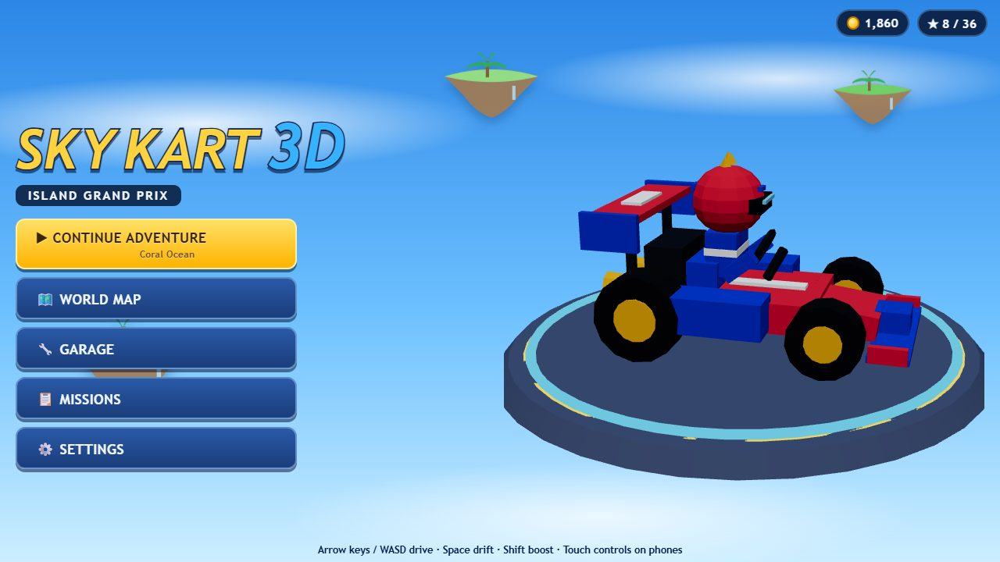

The **world map** shows the 12 tracks as cards with a picture, stars and a lock. Choosing a card shows its details on the side: laps, the shortcut's name, a description, the 3 track tasks, best time and best lap, and START RACE. Only open tracks can be started.

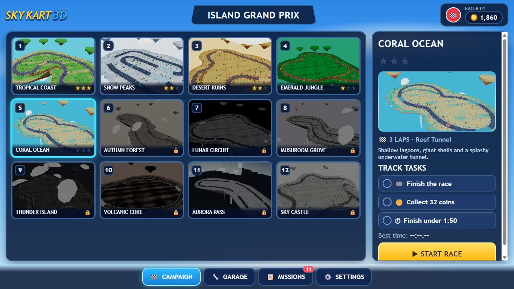

## The twelve tracks

Every track has its own road shape, colours, weather, scenery, a landmark, music and a shortcut with its own surface and dangers. Lap lengths are 1.2 to 1.7 km.

| No. | Track | What makes it different | Weather | Shortcut | Saves |
|---|---|---|---|---|---|
| 1 | Tropical Coast | beaches, palms, a lighthouse | sunny | Sand Spit (dirt) | 43 % |
| 2 | Snow Peaks | zig-zag mountain road, two hairpins, ice | snow | Ice Slide (ice) | 49 % |
| 3 | Desert Ruins | long straights, pillars, pyramids, rolling boulders | dust | Temple Cut (dirt) | 31 % |
| 4 | Emerald Jungle | twisting vines, muddy bends, a temple | fireflies | Vine Bridge (dirt, ramp) | 45 % |
| 5 | Coral Ocean | lagoons, giant shells, coral | sparkles | Reef Tunnel (water) | 37 % |
| 6 | Autumn Forest | golden leaves, windmill, fast S-bends | falling leaves | Deer Trail (dirt) | 44 % |
| 7 | Lunar Circuit | **low gravity**, long jumps, a blue planet in the sky | none | Crater Cut (road, big jump) | 19 % |
| 8 | Mushroom Grove | giant mushrooms, glowing spores, long hairpin | fireflies | Spore Path (dirt, bounce ramp) | 50 % |
| 9 | Thunder Island | stormy five-corner circuit, lightning | rain | Bolt Bridge (road) | 31 % |
| 10 | Volcanic Core | hot rock, lava glow, a volcano | embers | Ash Bridge (dirt, boulder) | 17 % |
| 11 | Aurora Pass | icy night roads under northern lights | sparkles | Glacier Run (ice) | 46 % |
| 12 | Sky Castle | the finale: jumps, boulders, a castle | petals | Royal Bridge (road, jump, 2 boulders) | 44 % |

"Saves" is how much shorter the shortcut is than the piece of main road it skips. Over 3 laps the shortcuts save 3 to 18 seconds; they are narrower and harder to drive.

| | | |
|---|---|---|
| 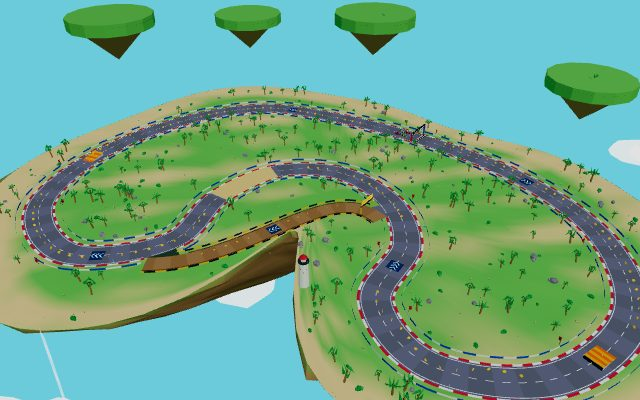 1. Tropical Coast | 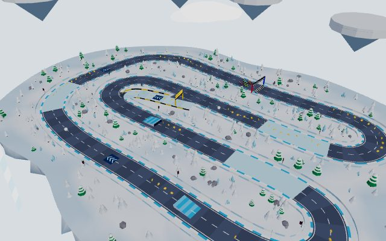 2. Snow Peaks | 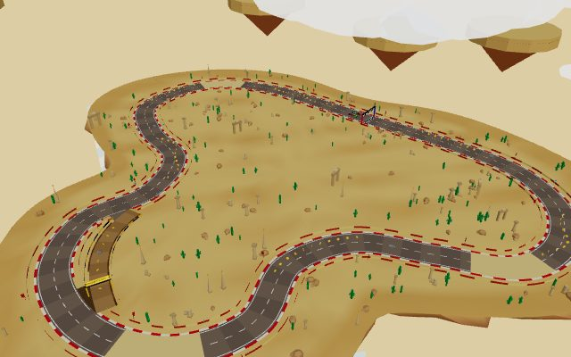 3. Desert Ruins |
| 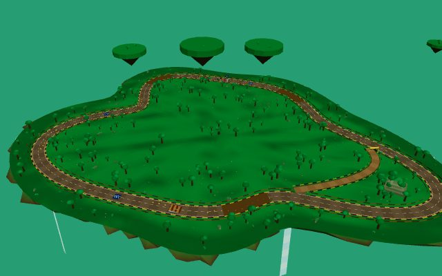 4. Emerald Jungle | 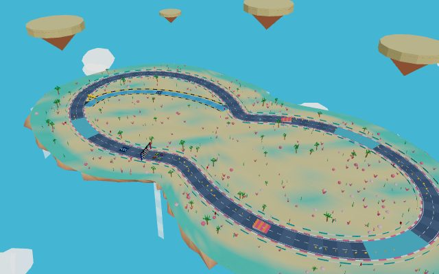 5. Coral Ocean | 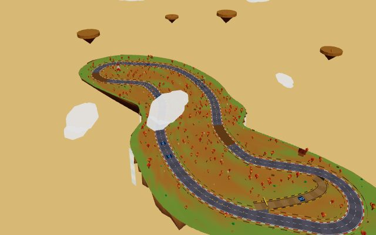 6. Autumn Forest |
| 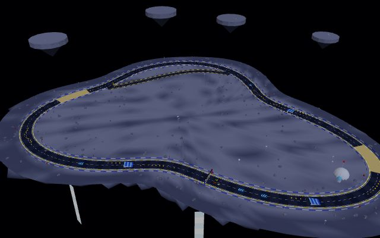 7. Lunar Circuit | 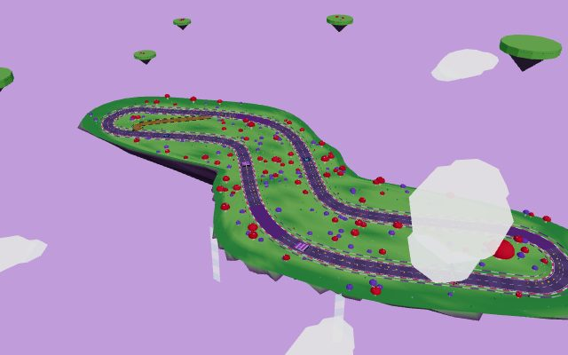 8. Mushroom Grove | 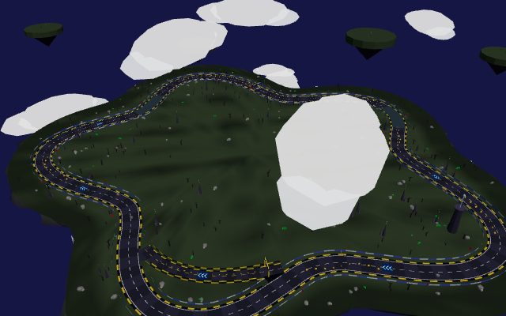 9. Thunder Island |
| 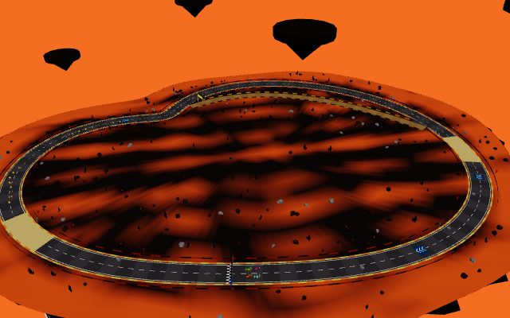 10. Volcanic Core | 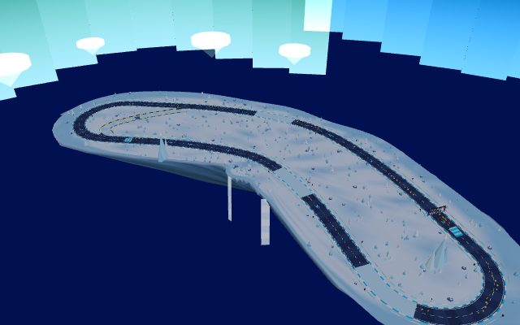 11. Aurora Pass | 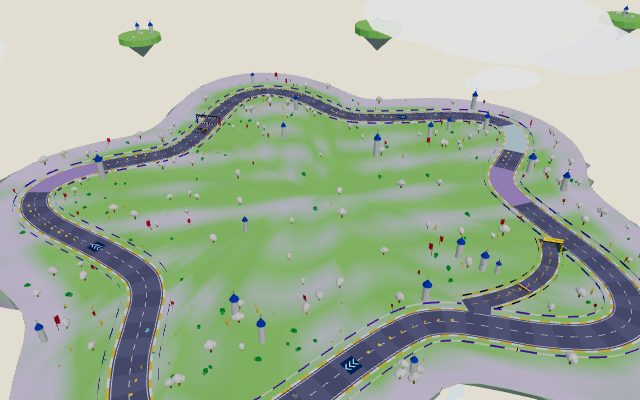 12. Sky Castle |

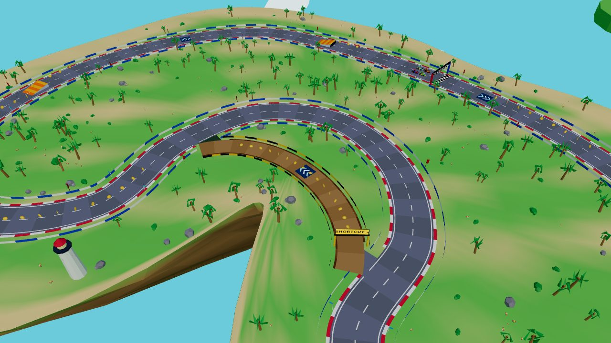

| | |
|---|---|
| 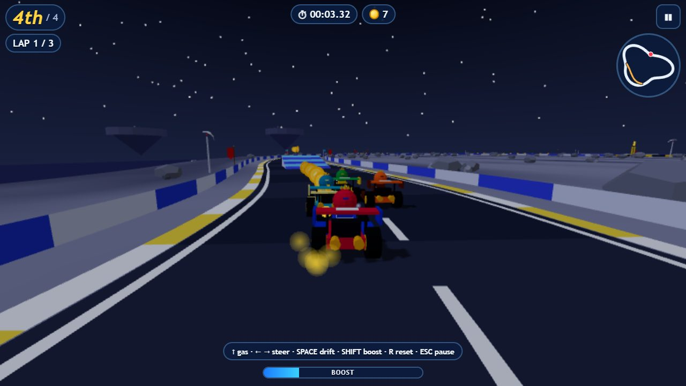 Lunar Circuit at night, low gravity | 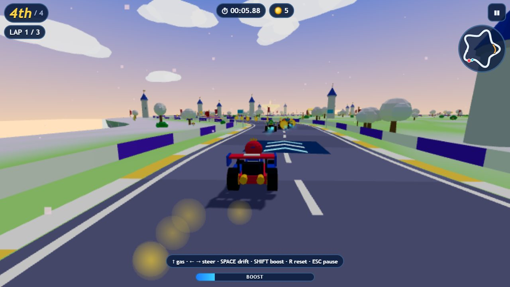 Sky Castle, the last track |

## A race

* 4 karts: you and 3 rivals (Rusty, Mochi, Gus, Vex, Piper or Brick, depending on the track). 3 laps. A 3-2-1-GO countdown.
* **Checkpoints** (blue flags): a lap only counts after all of them, in order.
* **Live position**, lap, timer, coins and a minimap with every kart.
* **Coins** lie on the road and come back every lap. They also fill the boost bar a little.
* **Drifting**: hold drift while steering. Sparks turn blue, then orange, then purple; let go for a mini-boost of 0.75, 1.3 or 2 seconds.
* **Boost bar**: fills while drifting, from coins and pads. Hold BOOST to use it.
* **Boost pads** (blue arrows) and **ramps** that launch the kart into the air.
* **Surfaces**: dirt and water slow you a little, sand slows you a lot, ice is slippery. Grass beside the road is slow.
* **Dangers**: swinging boulders that spin you out, walls, bumping into other karts (heavy karts push light ones).
* **Safe recovery**: a kart that is stuck for 3.5 seconds, or drives the wrong way for 2.8 seconds, is put back on the road. R does it at once.
* **Look back** with C.
* The race ends when everyone has finished, or 8 seconds after you did.

## Stars, rewards and unlocking

| You finish | Stars | Coins for the place |
|---|---|---|
| 1st | 3 | 150 |
| 2nd or 3rd | 2 | 100 or 60 |
| 4th | 1 | 30 |
| did not finish | 0 | 0 |

* **Finishing a track in any place unlocks the next one.**
* Stars never go down. Each **new** star pays 100 coins, once.
* Each track has 3 **tasks**: finish the race, collect N coins (25 to 40) in one race, finish under a time (1:45 to 2:30). Each task pays 50 coins the first time.
* Coins picked up during the race are added too.
* Best time and best lap are kept per track.

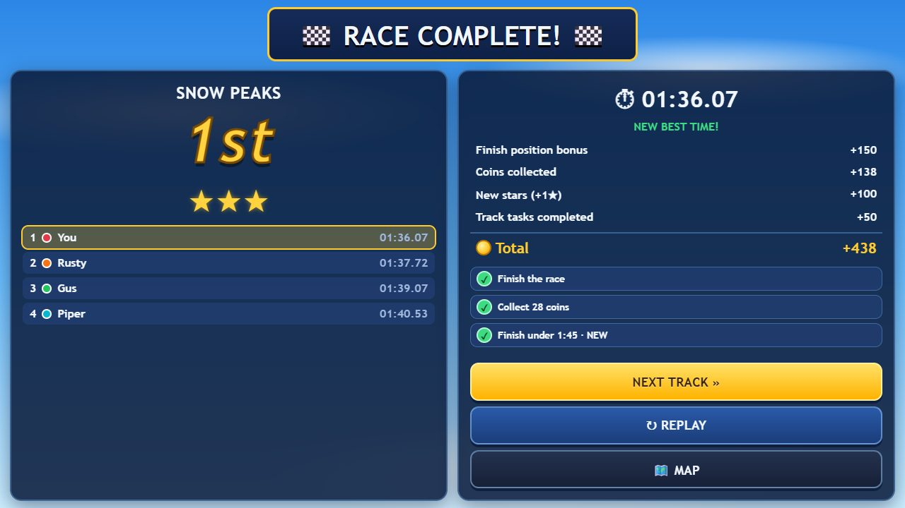

## Missions

20 missions count everything you do in all races. When one is complete, press **CLAIM** to get its coins. Each can be claimed only once.

| Mission | Reward | Mission | Reward |
|---|---|---|---|
| Collect 20 coins | 100 | Jump off 5 ramps | 150 |
| Collect 150 coins | 250 | Take 5 shortcuts | 250 |
| Collect 600 coins | 600 | Finish a race | 100 |
| Drift for 10 seconds | 100 | Finish 10 races | 400 |
| Drift for 60 seconds | 250 | Win a race | 200 |
| Drift for 5 minutes | 600 | Win 5 races | 500 |
| Use 3 boost pads | 150 | Win 12 races | 1 200 |
| Use 30 boost pads | 350 | Finish a race in under 2:30 | 300 |
| Boost for 20 seconds | 200 | Finish a race in under 2:00 | 600 |
| Earn 12 stars | 400 | Earn 30 stars | 1 000 |

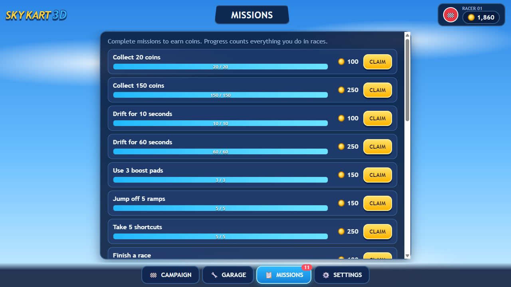

## The garage

| Kart | Price | Speed | Accel | Handling | Boost | Weight | In short |
|---|---|---|---|---|---|---|---|
| Comet | free | 5 | 5 | 5 | 5 | 3 | balanced, the first kart |
| Sprout | 700 | 4 | 7 | 8 | 5 | 2 | light, loves tight corners |
| Bulldog | 1 400 | 8 | 4 | 4 | 5 | 5 | heavy, huge top speed, pushes rivals |
| Stardust | 2 400 | 6 | 6 | 6 | 9 | 3 | fills the boost bar very fast |
| Skyhawk | 4 200 | 8 | 7 | 7 | 7 | 3 | the champion, strong at everything |

**Upgrades** (per kart, 5 levels each, +0.6 stat points per level): Engine (top speed), Gearbox (acceleration), Tyres (steering), Boost tank (boost fills faster and pushes harder). Levels cost 150, 250, 400, 600 and 900 coins. The stats really change the driving: top speed goes from 35 to 40 m/s across the scale, and the tests show better stats give faster laps.

**Looks** (no effect on driving). Each kart keeps its own paint.

| Kind | Free | Costs coins |
|---|---|---|
| 8 paints | Crimson, Solar, Lime | Ocean 150, Violet 150, Sunset 250, Gold 400, Midnight 400 |
| 5 drivers (helmet colours) | Ace | Nova 120, Kai 120, Rio 200, Jet 300 |
| 4 wings | Classic | Sleek (no wing) 100, Twin 180, Fin 250 |

| | |
|---|---|
| 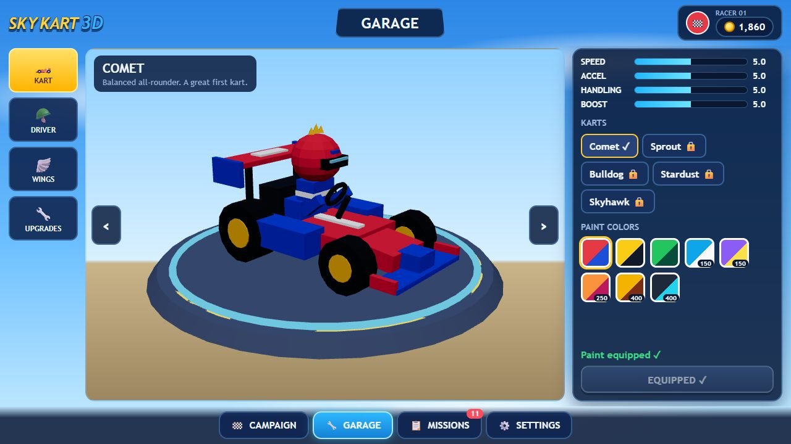 Kart tab: stats, karts, paint | 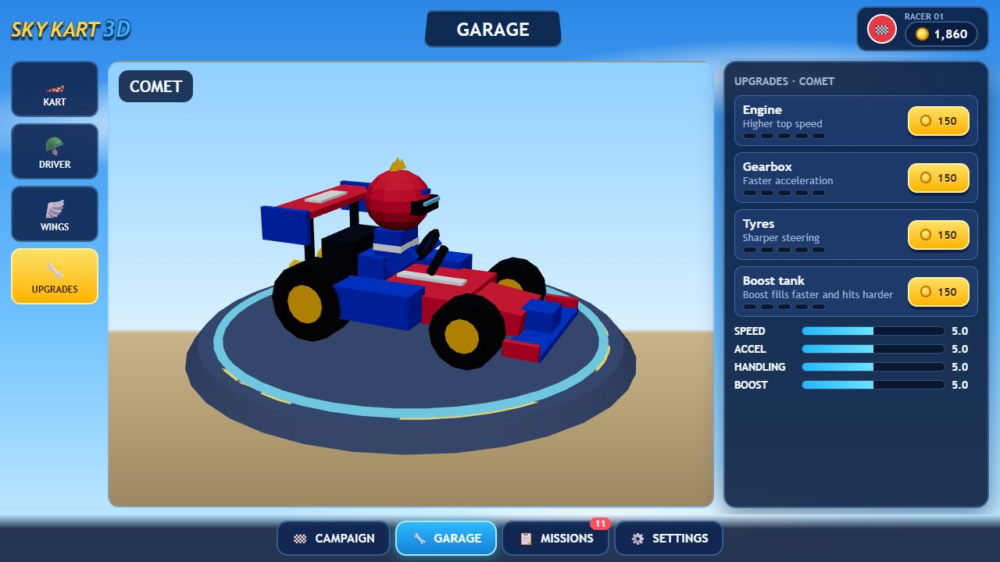 Upgrades tab |

## Controls

| Action | Keyboard | Gamepad | Touch |
|---|---|---|---|
| Accelerate | Up arrow / W | RT or A | automatic (or GAS button) |
| Brake / reverse | Down arrow / S | LT or B | BRAKE |
| Steer | Left / Right, A / D | left stick | joystick (analog) |
| Drift | Space | RB | DRIFT |
| Boost | Shift or B | X | BOOST |
| Look back | C | LB | |
| Put back on road | R | | |
| Pause | Esc or P | Start | pause button |

Touch controls appear on phones and tablets (and in any window narrower than 720 pixels). Several fingers work at once. **Auto-accelerate** is on by default on touch, so you only steer, drift, boost and brake; turn it off in Settings to get a GAS button.

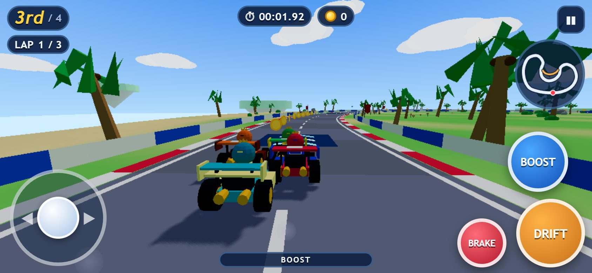

| | | |
|---|---|---|
| 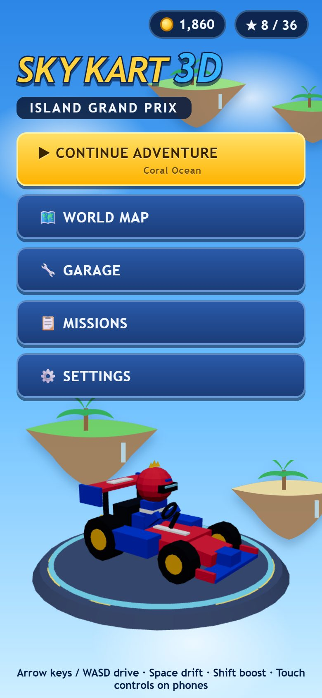 Phone, portrait: menu | 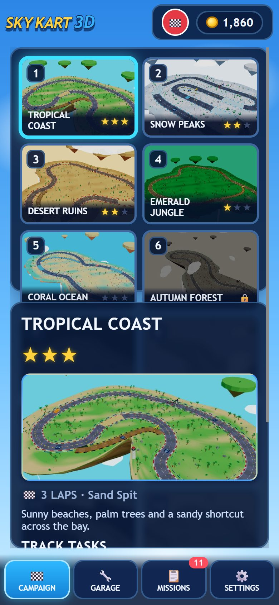 Phone, portrait: map | 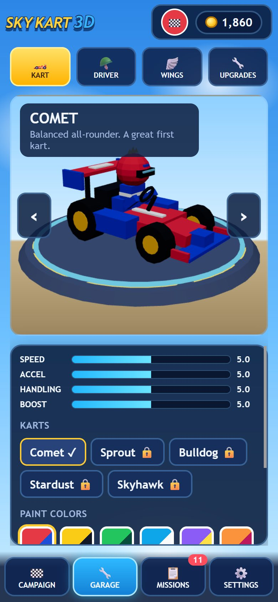 Phone, portrait: garage |

## Pause and settings

The race pauses with Esc, P or the pause button, and **by itself** when the window loses focus or the tab is hidden. Every held key and finger is released, and the race clock stops.

| | |
|---|---|
| 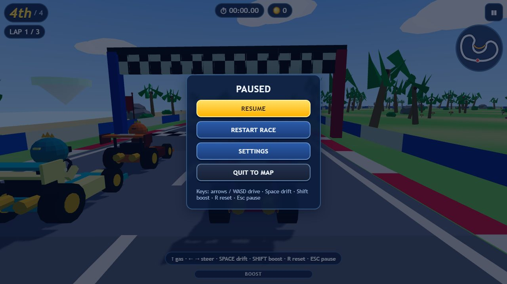 Pause: Resume, Restart race, Settings, Quit to map | 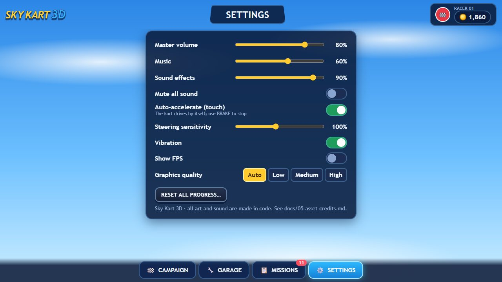 Settings |

Settings: master, music and effects volume; mute; auto-accelerate; steering sensitivity; vibration; show FPS; graphics quality (Auto, Low, Medium, High); reset all progress.

**Graphics quality** "Auto" picks Low on phones with 4 or fewer processor cores or 3 GB or less memory, Medium on other phones and on PCs with fewer than 8 cores, and High otherwise.

| Quality | Picture sharpness limit | Shadows | Smooth edges | Scenery | Sparks / weather |
|---|---|---|---|---|---|
| Low | 1 × | no | no | 45 %, fewer far islands, fog a little closer | 160 / 90 |
| Medium | 1.5 × | yes (1024 px) | no | 75 % | 320 / 220 |
| High | 2 × | yes (2048 px) | yes | 100 % | 520 / 220 |

## Sound and music

Every sound is made by the game's code when it starts: engine (its pitch follows the speed), drift, coins, boost, mini-boost, jumps, landings, bumps, hits, countdown, lap, finish and menu clicks. Each track has its own short music loop, and the menus have their own tune.

## Saving

Coins, stars, best times, unlocked tracks, task and mission progress, claimed rewards, owned karts, upgrades, paints, drivers, wings, the kart in use and all settings are saved in the browser after every change. Nothing is sent to any server.
